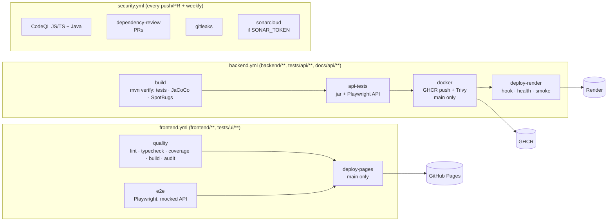

<p align="center"></p>

# StoryRail demo: Library Catalog

**StoryRail** puts a user story on rails: a squad of specialised AI agents takes it from the product owner's
GitHub issue to a signed-off release, with a human gate at both ends and a quality gate at every stage in between.
This repo is the first story it carried: a small library catalog (browse, search, filter, add, delete and toggle the
availability of books).

## The rail

| # | Stage | Who |
|---|---|---|
| 1 | Requirements | You run `/storyrail <issue>` → **Requirement fetch** agent reads that issue (user story or bug) |
| 2 | Build | **Frontend dev** ∥ **Backend dev**, each with unit tests |
| 3 | Isolated tests | **Isolated UI automation** (after FE) ∥ **API automation** (after BE) |
| 4 | Review + local scan | **Strict reviewer** (read-only) ∥ **Local quality scan** (Sonar rules, SAST, secrets, dependencies) |
| 5 | Fix | **Review fixer** fixes both reports in one pass; re-check, max 2 rounds |
| 6 | CI/CD → QA | GitHub Actions re-runs every check and deploys to QA |
| 7 | QA environment | **Smoke test** → **Manual QA** on the deployed QA URL |
| 8 | Sign-off | **You** accept the story for UAT / production |

Defects found in QA go through a shorter **defect loop** (bug ticket → fix in the affected lane only → regression
test → diff review + scan → CI/CD → smoke → targeted re-test). Full definitions: [docs/storyrail/PIPELINE.md](docs/storyrail/PIPELINE.md).

## How to run it

One-time setup on your Mac: [docs/storyrail/SETUP.md](docs/storyrail/SETUP.md). Run **one story or bug at a time**:
the dashboard and your working folder follow a single run.

**Before each run**

```bash
cd storyrail
git switch main && git pull
node scripts/storyrail-dashboard.mjs     # leave this terminal open
```

Open the `storyrail` folder in **IBM Bob**, and open **http://localhost:4800** on a second screen. The dashboard comes
alive as soon as the run starts.

### A. A new user story

1. **The analyst creates the issue** with the **User story** template: the story ("As a … I want … so that …"),
   numbered acceptance criteria (`AC1`, `AC2`, …) and the **Frontend** / **Backend** ticks. Note the number, e.g. **#51**.
2. **Start the run** in the Bob chat: `/storyrail 51` (stories that belong together: `/storyrail 51 52`).
3. **Answer when it stops.** It only pauses here:

   | When | It asks | You answer |
   |---|---|---|
   | Requirement fetch | Questions about unclear acceptance criteria (only if any) | Your answers; it posts them on the issue |
   | Before merge | "PR #X is green. Merge and deploy to QA?" | **yes** |
   | After manual QA | Which defects to fix now (only if QA found any) | e.g. "fix all majors, rest to backlog" |
   | Sign-off | "Approve?" | **approve** |

4. **Result:** the code is merged and deployed to the [QA site](https://anandhan-naveen.github.io/storyrail/), the issue
   gets a summary comment and is closed, and the reports are saved in `runs/issue-51/`.

Defects that manual QA finds *during* a story run are handled inside that run: StoryRail creates the bug issues and
fixes them before sign-off. You don't need part B for those.

### B. A new bug (found outside a story run)

1. **The analyst creates the issue** with the **Bug** template: steps to reproduce, expected, actual (with a screenshot
   if possible), lane and severity. Note the number, e.g. **#52**.
2. **Start the defect loop:** `/storyrail fix 52` (several bugs: `/storyrail fix 52 53`).
3. **Answer when it stops:** questions about the bug (only if steps or expected are missing), and
   "PR #X is green. Merge and deploy to QA?" → **yes**.
4. **Result:** the fix ships with a regression test, the PR closes the bug, and manual QA re-tests it on the QA site and
   comments **"Verified on QA"**. If it isn't fixed, the issue is reopened and you are asked what to do.

### Handy anytime

| Want to… | Type |
|---|---|
| See where a run is | `/storyrail status` |
| Resume after you fixed or answered something | `continue` |
| Keep your Mac awake during a run | `caffeinate -i` in another terminal |

## What's in the repo

| Part | Stack | Docs |
|---|---|---|
| `frontend/` | React 18, TypeScript, Vite, Vitest | [frontend/README.md](frontend/README.md) |
| `backend/` | Spring Boot 3.5, Java 21, H2, JaCoCo, SpotBugs, PMD | [backend/README.md](backend/README.md) |
| `docs/api/openapi.yaml` | Books API contract (single source of truth) | |
| `tests/ui/` | Playwright UI tests (mocked API or real backend) | [tests/ui/README.md](tests/ui/README.md) |
| `tests/api/` | Playwright API contract tests | [tests/api/README.md](tests/api/README.md) |
| `tests/manual/` | Charters, manual test cases, run log | [tests/manual/](tests/manual/) |

- **Issues (user stories + acceptance criteria):** [01 frontend](issues/01-frontend-library-catalog.md) ·
  [02 backend](issues/02-backend-books-api.md)
- **Agents (IBM Bob custom modes):** [.bob/custom_modes.yaml](.bob/custom_modes.yaml) · briefs `.bob/rules-sr-*/` · orchestrator [.bob/rules-sr-orchestrator/](.bob/rules-sr-orchestrator/01-orchestrator.md) · `/storyrail` command [.bob/commands/storyrail.md](.bob/commands/storyrail.md) · conventions [.bob/rules/01-project-guide.md](.bob/rules/01-project-guide.md)
- **Test traceability (AC → tests):** [UI](tests/ui/README.md#ac--test-traceability) ·
  [API](tests/api/README.md#traceability) · [manual](tests/manual/test-cases.md)
- **Deployment:** [docs/DEPLOYMENT.md](docs/DEPLOYMENT.md)

## Pipelines



Dependabot (`.github/dependabot.yml`) opens weekly grouped minor/patch updates for npm, Maven, Docker and Actions.

## Run locally

Requirements: Node 22, Java 21, Maven 3.9+.

**Frontend** (demo mode, no backend needed):

```bash
cd frontend
npm ci
npm run dev                                   # http://localhost:5173/#/
npm run lint && npm run typecheck && npm run test:coverage && npm run build
```

**Backend:**

```bash
cd backend
mvn verify                                    # unit tests, JaCoCo 80 % gate, SpotBugs
mvn spring-boot:run                           # http://localhost:8080 (H2, seeded with 8 books)
```

**Frontend against the backend:**

```bash
cd frontend && VITE_API_BASE_URL=http://localhost:8080 npm run dev
```

**UI tests** (builds the app into `tests/ui/.app-dist`, so install `frontend/` deps first):

```bash
(cd frontend && npm ci)
cd tests/ui
npm ci
npx playwright install --with-deps chromium
npx playwright test                           # mocked API
E2E_REAL_API=http://localhost:8080 npx playwright test   # against a running backend
```

**API tests** (backend running on :8080):

```bash
cd tests/api
npm ci
API_BASE_URL=http://localhost:8080 npx playwright test
```
